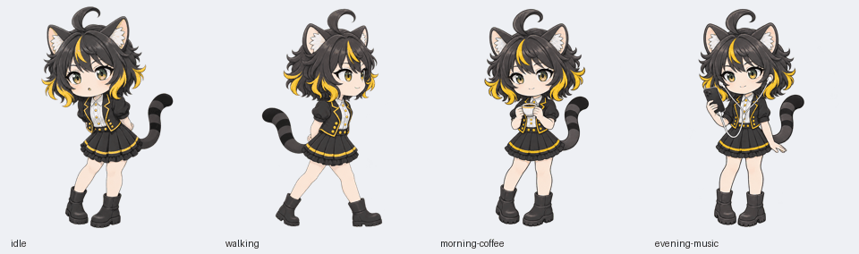

# MIA desktop · 米亞桌寵 3.2

Windows 桌面上的貓精靈夥伴，使用 C#、.NET 8 與 WPF 製作。支援陪伴、探索窗沿、跨螢幕活動、玩球，以及可選的 AI 對話與情緒語音。

## 版本目標

| 版本 | 目標 |
| --- | --- |
| [3.1](https://github.com/Jason0102/MIA-desktop/tree/3.1) | 高互動性的桌寵介面。米亞能在桌面活動，回應游標、觸摸、拖曳與玩球。 |
| [3.2](https://github.com/Jason0102/MIA-desktop/tree/3.2) | 整合 Hermes 的多用途個人助理。透過對話指派任務、使用工具並取得成果。 |
| [3.3](https://github.com/Jason0102/MIA-desktop/tree/3.3) | 具備互動記憶與持續心情的個人化助理。米亞根據互動與對話情境調整語氣、動畫及語音，使用者可從後台查看互動紀錄。 |

**3.2** 由公開版 `3.1` 衍生，加入本機 Hermes 主代理、Codex 工作委派及 Windows 桌面工具。Hermes 模式由專用啟動腳本提供；直接開啟 `MIA.exe` 仍可使用原有對話。安裝及驗證方式見 [3.2 整合說明](docs/HERMES.md)。

## 動畫預覽

下載或 clone 後，直接用瀏覽器開啟 [動畫預覽.html](動畫預覽.html)。GitHub 檔案頁顯示 HTML 原始碼，請下載後開啟。

- [動作與生活動畫](art/v39-timed/index.html)：40 組、124 格，支援逐格、暫停、速度、鏡像、大小與對照。
- [情緒與語音試聽](情緒動畫預覽.html)：42 種情緒／說話方式、84 格，加上預設說話；附 43 段示範音訊，預覽不需要金鑰。
- [狀態流程圖](art/v36-preview/state-machine.svg)：探索、窗沿與玩球流程；時段動作規則另見預覽頁文字。



[查看生活動作總覽](art/v39-timed/contact-sheet.png)

## 已實作功能

| 範圍 | 目前行為 |
| --- | --- |
| 桌面呈現 | 透明、置頂角色；定期恢復置頂且不搶焦點；人物與介面各自支援 0.5–3 倍縮放 |
| 陪伴／探索 | 原地眨眼、16 方向視線、伸展與小動作；探索散步／跑步、短暫停留、接近游標時機率性注視 |
| 多螢幕 | 指定活動螢幕、自動儲存與重新偵測；螢幕拔除時移往可用區域 |
| 視窗互動 | 拖放窗沿坐下、探索跳上可達窗頂、沿窗移動；跟隨視窗，關閉／最小化／最大化及刻意晃動時解除支撐 |
| 玩球 | 拖曳投球、追球、踢球、輕撥、前撲、抱球走路、拋球、頂球；支援地面與窗頂之間的追逐 |
| 時段生活 | 深夜睡覺／打盹、上午咖啡／看書、下午飲料／畫畫、晚上魷魚串／音樂；依電腦時間觸發 |
| 對話介面 | 浮動膠囊橫幅、右鍵切換、停止、重播、靜音、設定自動套用 |
| 畫面附圖 | 主動框選畫面，多張預覽、個別移除；最多 6 張、合計 24 MB，送出後才附到請求 |
| AI 對話 | Responses SSE 串流、搜尋工具與可點擊來源、本地規則選擇推理強度、快取用量讀取 |
| 本地記憶 | 成功完成的對話存入 JSONL；重啟載入最近 10 輪；可清除，損壞單行可略過 |
| 語音／情緒 | 分句佇列、串流 PCM 播放、取消與清理；音訊標籤隱藏於聊天畫面，播放期間套用對應情緒動畫 |
| 角色 | 編輯 `src/Mia/role.json`（建置後位於執行檔旁）；每次請求附帶日期、時間與時區 |

完整程式對照與限制見 [功能盤點](docs/FEATURES.md)。

## 建置與啟動

需要 Windows x64 和 .NET 8 SDK（WPF／Windows Desktop）。在專案根目錄執行：

```powershell
./build.ps1 -Test
./dist/MIA-3.2-win-x64/MIA.exe
```

建置會輸出自帶 .NET runtime 的 Windows x64 版本。Hermes 安裝與首次設定完成後可雙擊 `啟動米亞.vbs`，退出使用 `退出米亞.vbs`。源碼版不內附 SDK。僅執行檢查：

```powershell
dotnet run --project tests/Mia.Checks.csproj -c Release
python scripts/check_public.py
```

一般檢查使用模擬 HTTP 服務，不呼叫付費 API。`--live`、`--setup-voice` 與 `--preview-audio` 是另行選用的開發工具，可能連線或產生費用。

## 金鑰與聲線

不設定金鑰也能使用桌寵動作與離線預覽。AI／TTS 功能需要自己的服務帳號及可用模型。

1. 複製 `api_key.example` 為 `api_key`，填入自己的 OpenAI 與 ElevenLabs 金鑰；或在設定介面填入。
2. 在設定填入可使用的 ElevenLabs Voice ID。公開版不包含個人聲線設定或克隆來源錄音。
3. 重新啟動，或透過介面套用設定。程式會由執行檔位置向上尋找 `api_key`。

目前程式預設模型字串為 `gpt-6.1-terra`／`eleven_v4`。這描述程式設定，並不保證服務端或你的帳號支援；可依帳號調整。實際網路搜尋、語音效果及延遲受服務影響。

## 資料與隱私

- 金鑰在本機設定中以 Windows DPAPI 保護，綁定目前 Windows 使用者；自行建立的 `api_key` 仍是明文，請妥善保管。
- 設定與對話預設位於 `%LOCALAPPDATA%/MIA/v3`，可用 `MIA_DATA_DIR` 指定其他目錄。
- 對話 JSONL 是明文。截圖不寫入對話記憶，但送出的附圖會傳給模型服務；語音文字會傳給 ElevenLabs。
- `api_key`、個人聲線、聊天紀錄、測試資料、建置輸出與封裝 ZIP 均排除於 Git。
- 公開角色設定使用通用範例；本機原始個人化角色檔不在本公開版內。

## 範圍與限制

這是 Windows 原生桌寵，不是 Codex／ChatGPT Pets 插件。語音動畫不是音素嘴型同步；預覽不模擬完整物理系統。本地記憶尚無語意搜尋或自動摘要。沒有在本次發佈驗證中使用真實付費 API，亦未重新執行完整多螢幕桌面互動驗收。

公開可閱不等於授予任意再散布或商用權；本版本尚未指定開源授權。角色圖像與示範音訊的再利用請先確認權利。

參見 [版本紀錄](CHANGELOG.md)、[開發與發佈](docs/DEVELOPMENT.md)、[公開內容說明](docs/PUBLICATION.md)。
